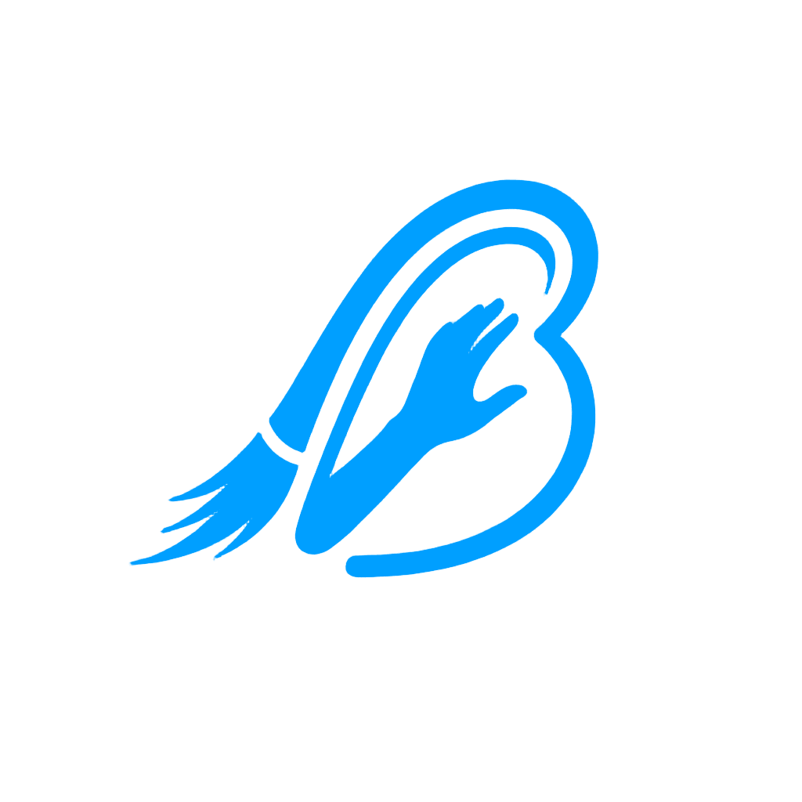
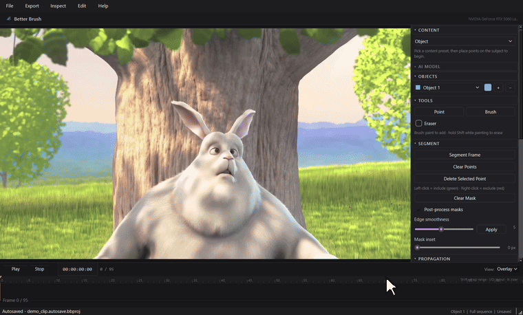
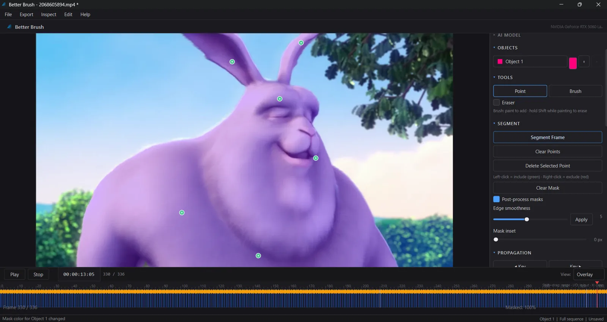
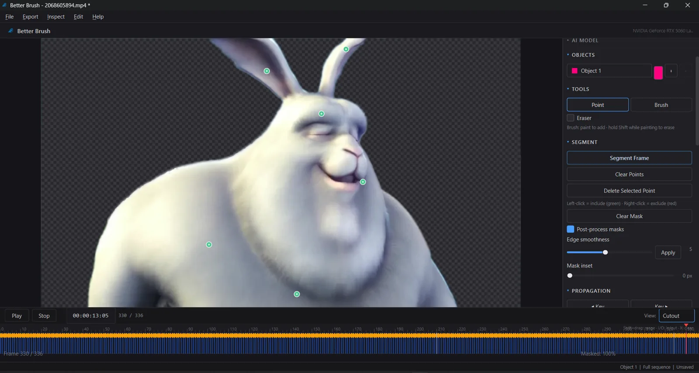
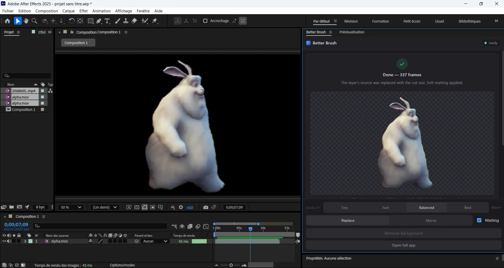
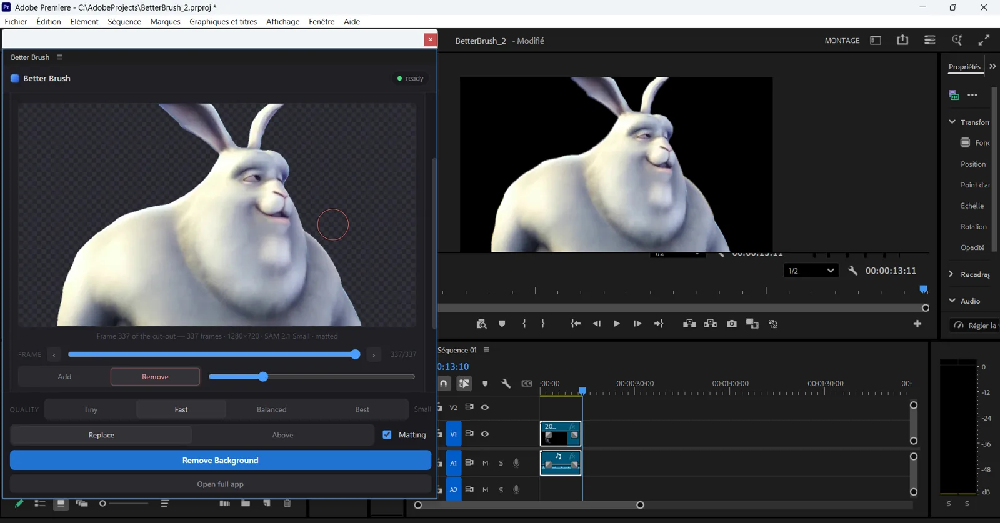
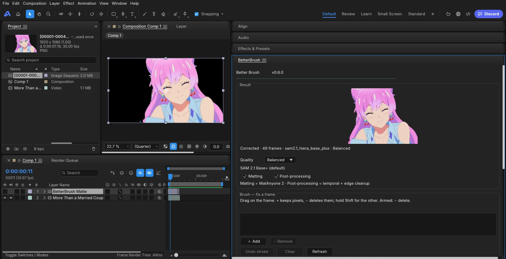

<p align="center">
  
</p>

<h1 align="center">Better&nbsp;Brush</h1>

<p align="center">
  <b>The AI rotoscoping studio for video editors.</b><br/>
  Click → Segment → Propagate → Refine → Remove → Export.
</p>

<p align="center">
  <a href="https://huggingface.co/Sneg0wo/better-brush">
    
  </a>
  <br/>
  <sub><b>All Windows builds are on <a href="https://huggingface.co/Sneg0wo/better-brush">Hugging Face</a>.</b> GitHub hosts the source and docs.</sub>
</p>

<p align="center">
  <a href="LICENSE"></a>
  
  
  
</p>

<p align="center"><b>100% local</b> · <b>100% free</b> · <b>source-available</b></p>

---

## Download and install

> **Install from [Hugging Face](https://huggingface.co/Sneg0wo/better-brush).**
> That page has the installer, the portable build, and the standalone panel
> installers. Nothing is downloaded from GitHub.

### Recommended — the installer

1. Open **[huggingface.co/Sneg0wo/better-brush](https://huggingface.co/Sneg0wo/better-brush)**.
2. In the **`installer/`** folder, download **all four files** into the same
   folder:
   `BetterBrush-1.0.2-Windows-Setup.exe` and the three `Setup-*.bin` parts.
3. Run the `.exe`. It installs Better Brush **and registers all three panels**
   (After Effects, Premiere Pro, EffectCraft) — there are no component choices.
4. Restart your editor. In After Effects or Premiere Pro, open
   **Window → Extensions → Better Brush**.

> **Why four files?** Windows caps a single `.exe` at 4.2 GB, so the installer
> ships as one `.exe` plus three `.bin` slices. All four are required — keep
> them together.

### Portable — no installer

1. In the **`portable/`** folder, download `BetterBrush-1.0.2-Windows.zip`
   (5.0 GB).
2. Extract the whole archive to a normal folder. Do not run it from the zip
   viewer.
3. Double-click **`BetterBrush.exe`**. For the editor panels, run
   **`Install Everything.bat`** once.

### Only need one editor panel?

The **`panels/`** folder has small standalone installers:

| After Effects | Premiere Pro | EffectCraft |
|---|---|---|
| `BetterBrush-AfterEffects-Setup-1.0.2.exe` | `BetterBrush-PremierePro-Setup-1.0.2.exe` | `BetterBrush-EffectCraft-Setup-1.0.2.cmd` |

They find the installed app and reuse its `.bb-env`. EffectCraft 0.17.0 is
required for that panel.

### Requirements

- **Windows 10/11, 64-bit.**
- An **NVIDIA GPU** is recommended; AMD/Intel works through DirectML and CPU
  works (slower). The app picks the strongest model that fits your VRAM.
- The **editor panels** need Python. **`Install Everything.bat`** installs it,
  creates `.bb-env`, pulls PyTorch and registers the panels in one go.

---

## See it work



<sub>Recorded from the real app on Big Buck Bunny (CC-BY, Blender Foundation).
Regenerate with `python tools/make_demo_gif.py`.</sub>



| Cutout view | Inside After Effects |
|---|---|
|  |  |

---

## What it does

- **Segment** — click to include, right-click to exclude. Anime, human and
  object presets, prompt-aware mask ranking, scene-cut detection.
- **Propagate** — SAM 2 tracks the subject across the shot, frame by frame.
- **Matte** — learned video matting for real hair and motion blur, guided-filter
  edge cleanup, optical-flow temporal smoothing, per-shot profiles.
- **Anime / AMV engine** — line lock snaps mattes to the pencil line, cel hold
  stops boiling on held drawings, letterbox bars are detected on import.
- **Remove** — AI video inpainting erases masked subjects and rebuilds the
  background; LaMa cleans subtitles and logos.
- **Refine** — brush that also acts as a SAM 2 prompt, with full undo/redo and
  overlay, cutout and raw views.
- **Inspect** — Matte QC Inspector, offline QC Coach, live GPU telemetry and
  checksummed version history.
- **Export** — PNG sequence, ProRes 4444, QuickTime Animation, or H.264 over a
  chroma-key background, up to 8K.

## Quick start

1. **Open a clip** — `Ctrl+O`, or drag a file in.
2. **Click the subject** — one include point is usually enough.
3. **Propagate to End** — watch the overlay solve across the shot.
4. **Refine** — `B` for the brush; paint corrections where it drifts.
5. **Inspect** — `Ctrl+Shift+M` runs the QC Inspector.
6. **Export** — `Ctrl+E`. Or queue several projects (`Ctrl+Shift+Q`).

Every step is reversible: re-segment, swap models, change a profile, or roll
back to a checkpoint. **Help → Quick Tutorial** gives a guided tour in-app.

---

## Inside your editors

The same engine powers three host panels: the panel is thin, the AI runs in a
local process, and nothing leaves your machine. Select a layer or clip, click
**Remove Background**, and it is rotoscoped in place.

| Host | Support | How to install |
|---|---|---|
| **After Effects** | AE 2022–2025 | Included in the app setup |
| **Premiere Pro** | PPro 2022–2025 | Included in the app setup |
| **EffectCraft** | 0.17.0 portable | Included in the app setup |



**EffectCraft:** the cut-out lands on the timeline as a track matte. Wrong frame?
Paint it — green keeps pixels, red deletes them — and **Apply fix & re-run**
re-tracks that frame with your strokes.



Panel guides: **[After Effects](after-effects/README.md)** ·
**[Premiere Pro](premiere-pro/README.md)** ·
**[EffectCraft](docs/EFFECTCRAFT.md)**.

---

## Fine-tune your own anime SAM 2

Better Brush is also a data engine for a custom model: the app proposes masks,
you correct the ones it gets wrong, and those corrections become the training
set. The full walkthrough names the result **Lugnica SAM**.

- **[Fine-tuning guide](docs/FINE-TUNING.md)** — full recipe and per-GPU settings.
- **[Build Lugnica SAM](docs/LUGNICA-SAM.md)** — the simple step-by-step.
- **[Colab kit](tools/sam2_training/colab/README.md)** — train in a browser on a
  free T4, no local GPU needed.

## Documentation

**Read the docs online:** https://snegowo.github.io/Better-Brush/

| Guide | Contents |
|---|---|
| [User Guide](docs/USER-GUIDE.md) | The complete editor-facing workflow |
| [Complete Feature Reference](docs/COMPLETE-FEATURES.md) | Every feature and system, in depth |
| [Anime & AMV Engine](docs/ANIME-AMV.md) | Line lock, cel hold, letterbox, anime QC |
| [EffectCraft](docs/EFFECTCRAFT.md) | Install, workflow, brush, troubleshooting |
| [Developer Guide](docs/DEVELOPER-GUIDE.md) | Architecture, algorithms, persistence, build |
| [Fine-tuning](docs/FINE-TUNING.md) · [Lugnica SAM](docs/LUGNICA-SAM.md) | Train your own model |

---

## Build from source

For development, or if you prefer a Python environment you control:

```bash
git clone https://github.com/SnegOwo/Better-Brush.git
cd Better-Brush

python -m venv .venv
.venv\Scripts\activate            # source .venv/bin/activate on macOS/Linux

# CUDA PyTorch FIRST — plain `pip install torch` is CPU-only on Windows:
pip install torch torchvision --index-url https://download.pytorch.org/whl/cu128

pip install -r requirements.txt
python -m src.main
```

The first segmentation downloads a SAM 2.1 checkpoint (~150 MB); matting,
removal and fine-tuning weights download on first use. Optional extras:
`scenedetect` (sharper cuts), `mediapipe` (face parts), `onnxruntime` (LaMa on
CPU), `-e ".[sam3]"` (SAM 3.1).

## Development

```bash
python -m pytest tests/ -q                          # 538 tests, no GPU required
python -m pytest extensions/effectcraft/tests -q    # EffectCraft bridge (104 tests)
python -m ruff check src/                           # lint
pyinstaller --clean better_brush.spec               # developer build
```

Vendored packages and licenses: [src/vendor/README.md](src/vendor/README.md).

## License

Better Brush is **source-available** under the
[Functional Source License 1.1, MIT Future License](LICENSE) (FSL-1.1-MIT).
You can read, fork, modify, build and share it, and use it to make **any video —
including monetised YouTube, TikTok and AMV edits**. The videos you create are
yours.

You may **not** resell Better Brush, sell the source code, or ship it inside a
competing or paid rotoscoping/video tool. On **2028-10-23** the license converts
to **MIT** and those restrictions disappear.

Some bundled AI weights have their own non-commercial terms (MatAnyone 2,
NTU S-Lab License 1.0; MiniMax-Remover, CC-BY-NC-4.0). See
[THIRD-PARTY-NOTICES.md](THIRD-PARTY-NOTICES.md) before commercial work, and
[CONTRIBUTING.md](CONTRIBUTING.md) for the development setup.

## Star History

<a href="https://www.star-history.com/?repos=snegowo%2Fbetter-brush&type=date&legend=top-left">
 <picture>
   <source media="(prefers-color-scheme: dark)" srcset="https://api.star-history.com/chart?repos=snegowo/better-brush&type=date&theme=dark&legend=top-left" />
   <source media="(prefers-color-scheme: light)" srcset="https://api.star-history.com/chart?repos=snegowo/better-brush&type=date&theme=light&legend=top-left" />
   
 </picture>
</a>

<div align="center">

**© 2026 Sneg — Sneg HQ, a company of Lugunica** · [sneg.dev](https://sneg.dev)

</div>
