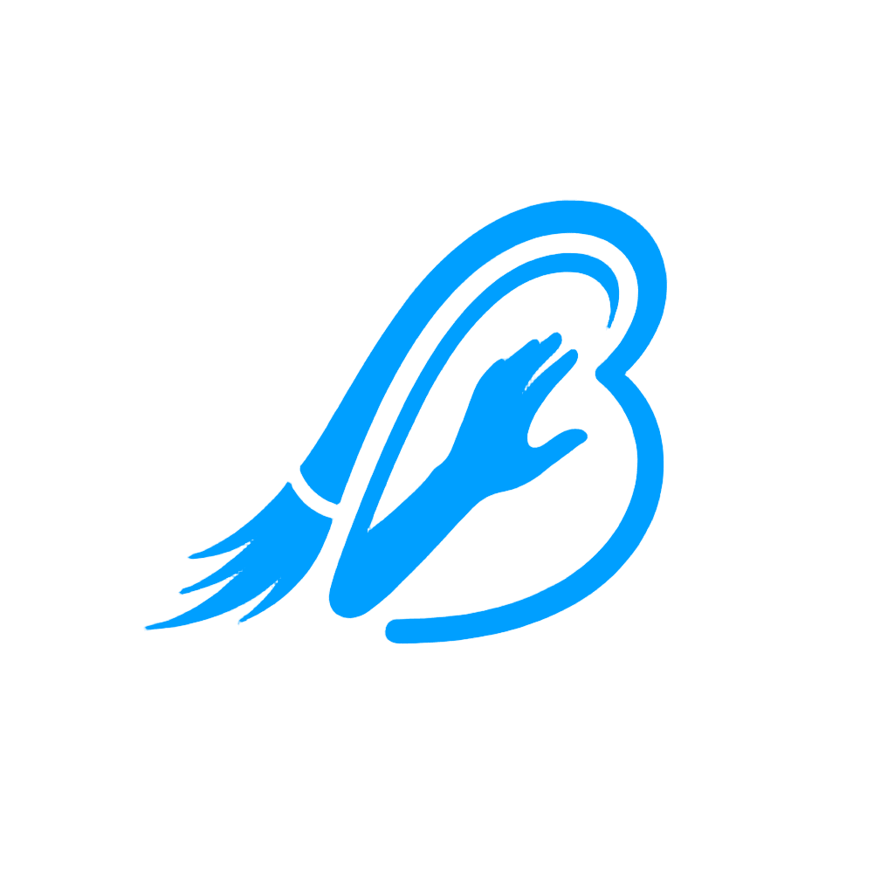

<p align="center">
  
</p>

<h1 align="center">Better&nbsp;Brush</h1>

<p align="center">
  <b>The AI rotoscoping studio for video editors.</b><br/>
  Click → Segment → Propagate → Refine → Remove → Export.
</p>

<p align="center">
  <a href="LICENSE"></a>
  <a href="https://sneg.dev/BetterBrush"></a>
  
  
  
  
</p>

<p align="center"><b>100% local.</b> Your footage never leaves your machine.</p>

---

Better Brush turns any clip into a production-ready alpha matte in a few clicks:
prompt **SAM 2** on a single frame, let it propagate the subject across the
timeline, build a **soft matte** with real hair and motion-blur detail, **paint
unwanted subjects out**, then export transparent ProRes 4444 or a PNG sequence
straight into your edit. It's tuned first for **anime / AMV** — crisp line art,
flat cel shading, thin hair strands — and handles live-action just as well.

## Highlights

- **Segment** — point prompts (click to include, right-click to exclude), prompt-aware
  mask ranking, anime/human/object presets, scene-cut detection, optional face-part.
- **Matte** — learned video matting (MatAnyone) for true soft alpha, guided-filter edge
  cleanup, optical-flow temporal smoothing, per-shot profiles.
- **Anime / AMV engine** — **line lock** snaps mattes to the pencil line and rejects
  background line art, **cel hold** kills boiling on held drawings, and baked-in
  letterbox bars are detected on import.
- **Remove** — AI video inpainting erases masked subjects and rebuilds the background;
  LaMa subtitle/logo cleanup with CPU fallback.
- **Refine** — brush (hold `Shift` to erase) that also acts as a SAM 2 prompt, full
  undo/redo, overlay/cutout/raw views.
- **Inspect** — Matte QC Inspector with issue evidence, an offline QC Coach, live GPU
  telemetry, and checksummed version history.
- **Export** — PNG sequence, ProRes 4444, QuickTime Animation, or H.264 with chroma-key
  backgrounds; soft mattes and spill controls applied at render time.
- **Bring your own model** — correct masks export straight into a SAM 2 fine-tuning
  dataset (see below).

## Install

```bash
git clone https://github.com/SnegOwo/Better-Brush.git
cd Better-Brush

python -m venv .venv
.venv\Scripts\activate            # Windows (source .venv/bin/activate on Unix)

# CUDA build of PyTorch FIRST — plain `pip install torch` is CPU-only on Windows:
pip install torch torchvision --index-url https://download.pytorch.org/whl/cu128

pip install -r requirements.txt
python -m src.main
```

The first segmentation downloads a SAM 2.1 checkpoint (~150 MB); matting, removal and
fine-tuning weights download on first use. Optional extras: `scenedetect` (sharper cuts),
`mediapipe` (face parts), `onnxruntime` (LaMa on CPU), `-e ".[sam3]"` (SAM 3.1).

**Auto model selection** maps your GPU's *total* VRAM to the strongest tier that keeps
~35% headroom — SAM 2.1 Tiny→Large, EfficientTAM for small GPUs, and optional SAM 3.1.

## Quick start

1. **Open a clip** — `Ctrl+O`, or drag a file in.
2. **Click the subject** — one include point is usually enough.
3. **Propagate to End** — watch the overlay solve across the shot.
4. **Refine** — `B` for the brush; paint corrections where it drifts.
5. **Inspect** — `Ctrl+Shift+M` runs the QC Inspector.
6. **Export** — `Ctrl+E`. Or queue several projects (`Ctrl+Shift+Q`).

Every step is reversible — re-segment, swap models, change a profile, or roll back to a
checkpoint at any time. Open **Help → Quick Tutorial** for a guided tour in-app.

## Fine-tune your own anime SAM 2

Better Brush is the data engine for a custom model: the app proposes masks, you correct
the ones it gets wrong, and those corrections become the training set. A full walkthrough
that names the result **Lugnica SAM** lives in
**[docs/LUGNICA-SAM.md](docs/LUGNICA-SAM.md)**.

- **[Fine-tuning guide](docs/FINE-TUNING.md)** — the full recipe and per-GPU settings.
- **[Build Lugnica SAM](docs/LUGNICA-SAM.md)** — the simple, opinionated step-by-step.
- **[Colab kit](tools/sam2_training/colab/README.md)** — train in the browser on a free
  T4 (or L4/A100), no local GPU needed.

## Editions

| | **Lite** — free | **Pro** — €5 one-time |
|---|:---:|:---:|
| Segmentation, brush, propagation, learned matting, object removal | ✅ | ✅ |
| PNG / ProRes / QuickTime / MP4 export | ✅ ≤1080p | ✅ ≤8K |
| Multi-object scenes · original audio · recoding · no watermark | ❌ | ✅ |

Keys are issued offline (HMAC-signed) and activated under **Help → Activate Pro…** — no
account, no server, no telemetry. [Get Pro →](https://sneg.dev/BetterBrush)

## Documentation

| Guide | Contents |
|---|---|
| [User Guide](docs/USER-GUIDE.md) | The complete editor-facing workflow |
| [Anime & AMV Engine](docs/ANIME-AMV.md) | Line lock, cel hold, letterbox, anime QC |
| [Complete Feature Reference](docs/COMPLETE-FEATURES.md) | Every feature and system, in depth |
| [Developer Guide](docs/DEVELOPER-GUIDE.md) | Architecture, algorithms, persistence, build |
| [Fine-tuning](docs/FINE-TUNING.md) · [Build Lugnica SAM](docs/LUGNICA-SAM.md) · [Colab Kit](tools/sam2_training/colab/README.md) | Train your own model |
| [Audit Report](docs/AUDIT-REPORT.md) · [Roadmap](docs/ROADMAP-IDEAS.md) | Recent fixes · backlog |

Format support, keyboard shortcuts, troubleshooting and the FAQ live in the
[Complete Feature Reference](docs/COMPLETE-FEATURES.md).

## Development

```bash
python -m pytest tests/ -q                    # 420 tests, no GPU required
python -m ruff check src/                      # lint
pyinstaller --clean better_brush.spec          # developer build
```

Vendored packages and licenses: [src/vendor/README.md](src/vendor/README.md).

## License

Business Source License 1.1 (BUSL-1.1) — see [LICENSE](LICENSE). Personal, evaluation and
educational use is free; commercial production use requires a license. Converts to Apache
License 2.0 on 2030-09-11.

<div align="center">

**© 2026 Sneg — Sneg HQ, a company of Lugunica** · [sneg.dev](https://sneg.dev) · [Get Pro](https://sneg.dev/BetterBrush)

</div>
