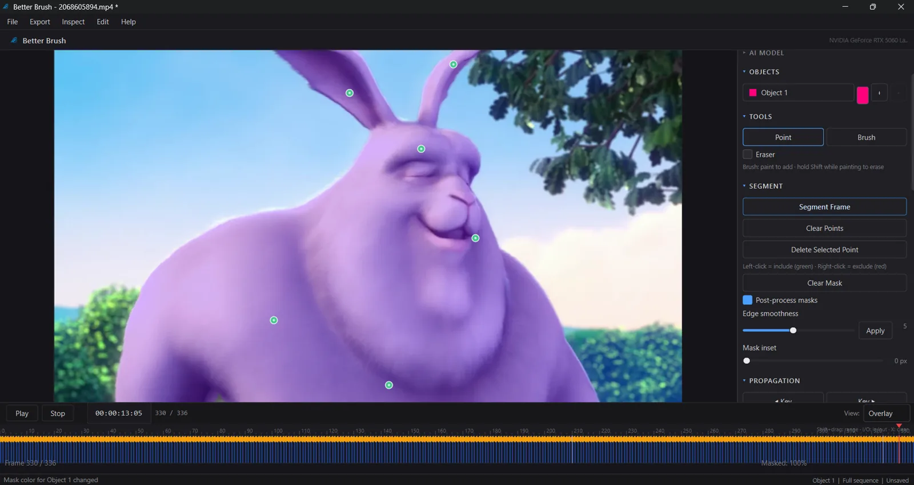
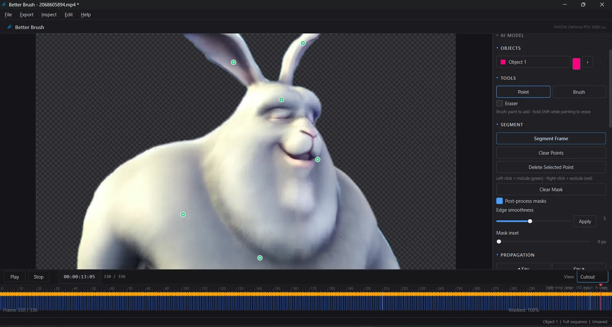
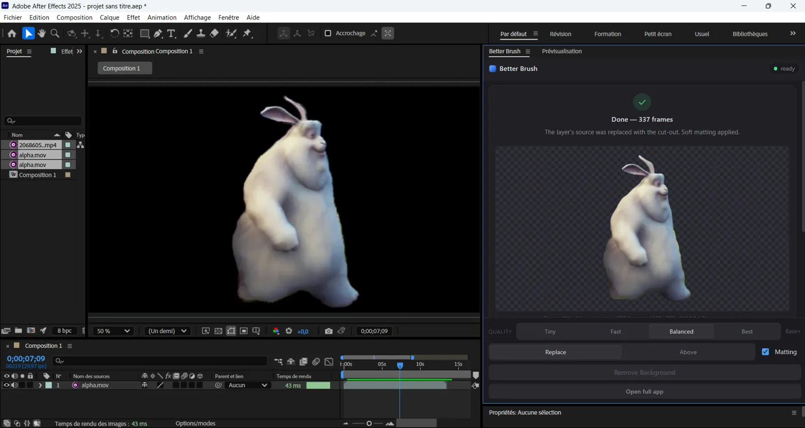
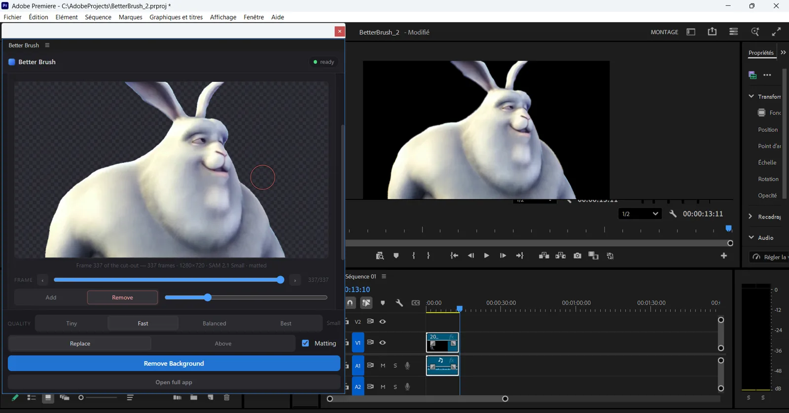
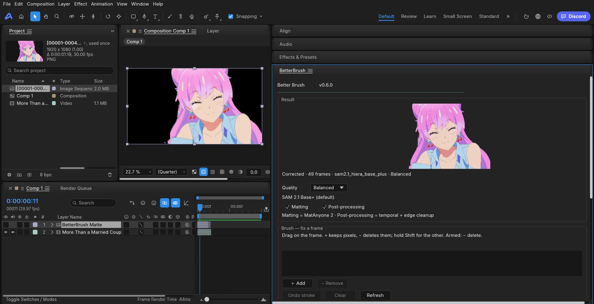

<p align="center">
  
</p>

<h1 align="center">Better&nbsp;Brush</h1>

<p align="center">
  <b>The AI rotoscoping studio for video editors.</b><br/>
  Click → Segment → Propagate → Refine → Remove → Export.
</p>

<p align="center">
  <a href="LICENSE"></a>
  
  
  
  
</p>

<p align="center"><b>100% local</b> · <b>100% free</b> · <b>source-available</b></p>

---

Better Brush turns any clip into a production-ready alpha matte in a few clicks:
prompt **SAM 2** on a single frame, let it propagate the subject across the
timeline, build a **soft matte** with real hair and motion-blur detail, **paint
unwanted subjects out**, then export transparent ProRes 4444 or a PNG sequence
straight into your edit. It's tuned first for **anime / AMV** — crisp line art,
flat cel shading, thin hair strands — and handles live-action just as well.

## Screenshots



| Cutout view | Inside After Effects |
|---|---|
|  |  |

<sub>Demo footage: Big Buck Bunny (CC-BY, Blender Foundation).</sub>

## Highlights

- **Segment** — point prompts (click to include, right-click to exclude), prompt-aware
  mask ranking, anime/human/object presets, scene-cut detection, optional face-part.
- **Matte** — learned video matting (MatAnyone) for true soft alpha, guided-filter edge
  cleanup, optical-flow temporal smoothing, per-shot profiles.
- **Anime / AMV engine** — **line lock** snaps mattes to the pencil line and rejects
  background line art, **cel hold** kills boiling on held drawings, and baked-in
  letterbox bars are detected on import.
- **Remove** — AI video inpainting erases masked subjects and rebuilds the background;
  LaMa subtitle/logo cleanup with CPU fallback.
- **Refine** — brush (hold `Shift` to erase) that also acts as a SAM 2 prompt, full
  undo/redo, overlay/cutout/raw views.
- **Inspect** — Matte QC Inspector with issue evidence, an offline QC Coach, live GPU
  telemetry, and checksummed version history.
- **Export** — PNG sequence, ProRes 4444, QuickTime Animation, or H.264 with chroma-key
  backgrounds; soft mattes and spill controls applied at render time.
- **Bring your own model** — correct masks export straight into a SAM 2 fine-tuning
  dataset (see below).

## Install

```bash
git clone https://github.com/SnegOwo/Better-Brush.git
cd Better-Brush

python -m venv .venv
.venv\Scripts\activate            # Windows (source .venv/bin/activate on Unix)

# CUDA build of PyTorch FIRST — plain `pip install torch` is CPU-only on Windows:
pip install torch torchvision --index-url https://download.pytorch.org/whl/cu128

pip install -r requirements.txt
python -m src.main
```

The first segmentation downloads a SAM 2.1 checkpoint (~150 MB); matting, removal and
fine-tuning weights download on first use. Optional extras: `scenedetect` (sharper cuts),
`mediapipe` (face parts), `onnxruntime` (LaMa on CPU), `-e ".[sam3]"` (SAM 3.1).

**Auto model selection** maps your GPU's *total* VRAM to the strongest tier that keeps
~35% headroom — SAM 2.1 Tiny→Large, EfficientTAM for small GPUs, and optional SAM 3.1.

## Quick start

1. **Open a clip** — `Ctrl+O`, or drag a file in.
2. **Click the subject** — one include point is usually enough.
3. **Propagate to End** — watch the overlay solve across the shot.
4. **Refine** — `B` for the brush; paint corrections where it drifts.
5. **Inspect** — `Ctrl+Shift+M` runs the QC Inspector.
6. **Export** — `Ctrl+E`. Or queue several projects (`Ctrl+Shift+Q`).

Every step is reversible — re-segment, swap models, change a profile, or roll back to a
checkpoint at any time. Open **Help → Quick Tutorial** for a guided tour in-app.

## Inside your editor

The same engine behind three host integrations: the panel is thin, the AI work
runs in a local headless process, and nothing leaves your machine.

| Host | Install | Status |
|---|---|---|
| **After Effects** | `powershell -ExecutionPolicy Bypass -File .\after-effects\install.ps1` | stable — AE 2022+ |
| **Premiere Pro** | `powershell -ExecutionPolicy Bypass -File .\premiere-pro\install.ps1` (elevated) | stable — PPro 2022+ |
| **EffectCraft** | `extensions\effectcraft\install.cmd` | **beta** — 0.17.0 portable only |

Select a footage layer (AE), a clip (Premiere) or a layer (EffectCraft), click
**Remove Background**, and it is rotoscoped in place. A replace keeps the clip's
own audio — the cut-out is the same footage minus the background.



Panels: **[After Effects](after-effects/README.md)** ·
**[Premiere Pro](premiere-pro/README.md)** ·
**[EffectCraft (beta)](docs/EFFECTCRAFT.md)**.

## Fine-tune your own anime SAM 2

Better Brush is the data engine for a custom model: the app proposes masks, you correct
the ones it gets wrong, and those corrections become the training set. A full walkthrough
that names the result **Lugnica SAM** lives in
**[docs/LUGNICA-SAM.md](docs/LUGNICA-SAM.md)**.

- **[Fine-tuning guide](docs/FINE-TUNING.md)** — the full recipe and per-GPU settings.
- **[Build Lugnica SAM](docs/LUGNICA-SAM.md)** — the simple, opinionated step-by-step.
- **[Colab kit](tools/sam2_training/colab/README.md)** — train in the browser on a free
  T4 (or L4/A100), no local GPU needed.

## Free, and fully unlocked

Better Brush is free, and **every feature is included** — no "Lite" tier, no
activation keys, no watermark, no account: segmentation, brush, propagation,
learned matting, AI object removal, PNG / ProRes / QuickTime / MP4 export up
to 8K, multi-object scenes, original-audio muxing and Library recoding.

## Documentation

**Read the docs online:** https://snegowo.github.io/Better-Brush/

| Guide | Contents |
|---|---|
| [User Guide](docs/USER-GUIDE.md) | The complete editor-facing workflow |
| [EffectCraft (beta)](docs/EFFECTCRAFT.md) | Install, workflow, brush, troubleshooting |
| [Anime & AMV Engine](docs/ANIME-AMV.md) | Line lock, cel hold, letterbox, anime QC |
| [Complete Feature Reference](docs/COMPLETE-FEATURES.md) | Every feature and system, in depth |
| [Developer Guide](docs/DEVELOPER-GUIDE.md) | Architecture, algorithms, persistence, build |
| [Fine-tuning](docs/FINE-TUNING.md) · [Build Lugnica SAM](docs/LUGNICA-SAM.md) · [Colab Kit](tools/sam2_training/colab/README.md) | Train your own model |
| [After Effects panel](after-effects/README.md) | One-click background removal inside AE (Windows, AE 2022+) |
| [Premiere Pro panel](premiere-pro/README.md) | The same panel ported to Premiere Pro (Windows, PPro 2022+) |

Format support, keyboard shortcuts, troubleshooting and the FAQ live in the
[Complete Feature Reference](docs/COMPLETE-FEATURES.md).

## Development

```bash
python -m pytest tests/ -q                    # 524 tests, no GPU required
python -m pytest extensions/effectcraft/tests -q   # the EffectCraft bridge (104 tests)
python -m ruff check src/                      # lint
pyinstaller --clean better_brush.spec          # developer build
```

Vendored packages and licenses: [src/vendor/README.md](src/vendor/README.md).

## License

Better Brush is **source-available** under the
[Functional Source License 1.1, MIT Future License](LICENSE) (FSL-1.1-MIT).
You can read, fork, modify, build and share it, and you can use it to make
**any video — including monetised YouTube, TikTok and AMV edits**. The videos
you create are yours.

You may **not** resell Better Brush, sell the source code, or ship it inside a
competing or paid rotoscoping/video tool. On **2028-10-23** the license
automatically converts to **MIT**, and those restrictions disappear.

Some bundled AI model weights are licensed separately for non-commercial use
(MatAnyone 2, NTU S-Lab License 1.0; MiniMax-Remover, CC-BY-NC-4.0). Those are
third-party terms and are unaffected by the code license — review
[THIRD-PARTY-NOTICES.md](THIRD-PARTY-NOTICES.md) if you plan commercial work.

See [CONTRIBUTING.md](CONTRIBUTING.md) for the development setup and the
contribution license.

## Better Brush inside EffectCraft (beta)

Select a footage layer, click **Remove Background**, and the cut-out lands on
your timeline as a track matte. Wrong frame? Paint it — green keeps pixels, red
deletes them — and **Apply fix & re-run** re-tracks that frame with your strokes.



> **Beta, source-only for now.** The panel and its background adapter work today
> but are young. **Tested on `effectcraft-0.17.0-windows-x64-portable` only** —
> 0.11.x and older cannot run panel timers at all.
> Install from source with `extensions\effectcraft\install.cmd`.
> The portable build and one-file setup arrive on **Hugging Face between 2 and
> 8 November**.
> Found something? [Open an issue](https://github.com/SnegOwo/Better-Brush/issues)
> with `panel.log` and `adapter.log`.

**[Read the EffectCraft guide →](docs/EFFECTCRAFT.md)** — install, workflow,
brush controls, troubleshooting, uninstall.

## Star History

<a href="https://www.star-history.com/?repos=snegowo%2Fbetter-brush&type=date&legend=top-left">
 <picture>
   <source media="(prefers-color-scheme: dark)" srcset="https://api.star-history.com/chart?repos=snegowo/better-brush&type=date&theme=dark&legend=top-left" />
   <source media="(prefers-color-scheme: light)" srcset="https://api.star-history.com/chart?repos=snegowo/better-brush&type=date&legend=top-left" />
   
 </picture>
</a>

<div align="center">

**© 2026 Sneg — Sneg HQ, a company of Lugunica** · [sneg.dev](https://sneg.dev)

</div>
